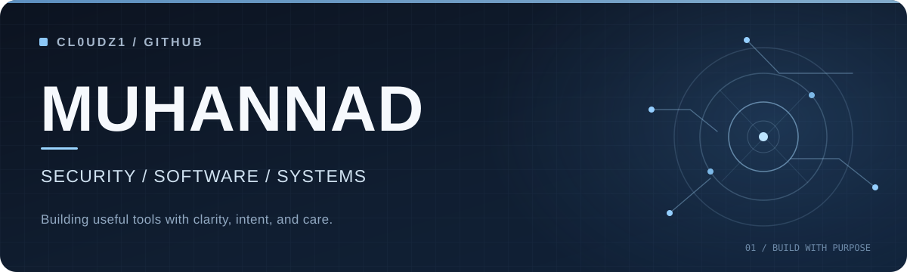

  

  <strong>Security-focused developer · Systems thinker · Community builder</strong>

  I build developer tools, explore defensive security, and engineer practical systems at the intersection of software and AI.

  <a href="https://github.com/cl0udz1?tab=repositories">Explore my work</a>
  &nbsp;·&nbsp;
  <a href="https://github.com/cl0udz1?tab=stars">What I'm exploring</a>

---

### Selected work

<table>
  <tr>
    <td width="50%" valign="top">
      <h3><a href="https://github.com/cl0udz1/siteshot">SiteShot</a></h3>
      A single-file Python and Playwright tool that discovers local web routes, captures screenshots, and generates review reports.  
      <strong>Developer tooling</strong> · Python · Playwright
    </td>
    <td width="50%" valign="top">
      <h3><a href="https://github.com/cl0udz1/mrd-swarm">MRD-SWARM</a></h3>
      A reproducible research framework for multi-agent drone simulation, flight dynamics, and decentralized coordination.  
      <strong>Simulation &amp; research</strong> · Python · MuJoCo
    </td>
  </tr>
  <tr>
    <td width="50%" valign="top">
      <h3><a href="https://github.com/cl0udz1/ArabicSlides">ArabicSlides</a></h3>
      An AI-agent-oriented toolkit for creating polished PowerPoint presentations with Arabic-first, right-to-left layout support.  
      <strong>Developer experience</strong> · HTML/CSS · Presentation tooling
    </td>
    <td width="50%" valign="top">
      <h3><a href="https://github.com/cl0udz1/notion-clone-sdc">Collaboration Hub</a></h3>
      A Notion-inspired collaborative workspace project using edge APIs, real-time editing, and Cloudflare services.  
      <strong>Web systems</strong> · TypeScript · Cloudflare · Y.js
    </td>
  </tr>
</table>

### What I care about

- **Defensive security:** making analysis, learning, and everyday security workflows clearer.
- **Practical software:** small tools with real utility, understandable architecture, and sensible defaults.
- **Intelligent systems:** applying AI where it measurably helps, rather than adding it for its own sake.
- **Learning in public:** building technical experiences and sharing knowledge through developer communities.

### Tools & areas

`Python` &nbsp; `TypeScript` &nbsp; `Go` &nbsp; `Linux` &nbsp; `Docker` &nbsp; `Cloudflare` &nbsp; `Security Engineering` &nbsp; `Applied AI`

### Also on my workbench

- [Cyber Guard Platform](https://github.com/cl0udz1/cyber_guard_platform) — a **student-project scaffold and architecture** for threat-intelligence workflows.
- [Cheetah Spine Experiment](https://github.com/cl0udz1/Cheetah-Spine-Experiment) — a controlled quadruped robotics simulation study.

---

  Less noise. Better systems. Work that matters.

